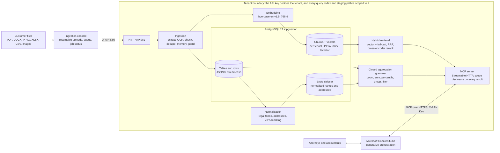
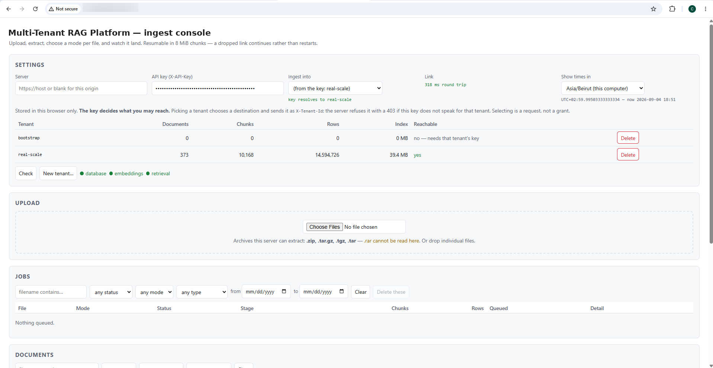
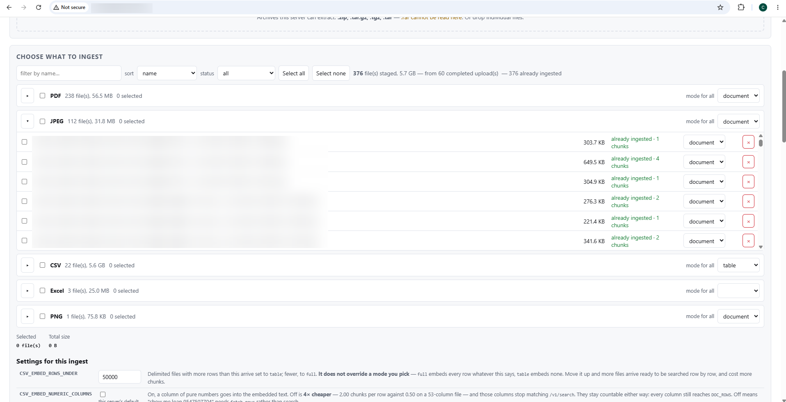
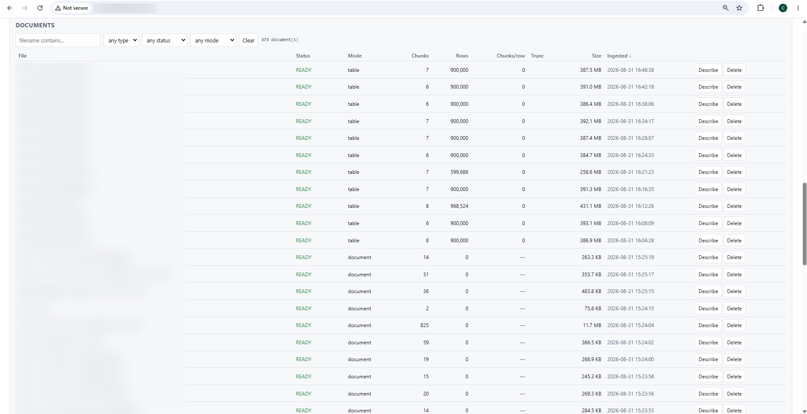

# Multi-Tenant RAG Platform

A retrieval-augmented generation platform that lets law and accounting firms ask questions of their own documents and data from inside Microsoft Copilot Studio. It ingests PDFs, Office files, scanned images and multi-million-row CSVs. Prose questions ("what does the agreement say") are answered by hybrid vector and full-text retrieval, and counting questions ("how many", "what is the total") by a closed SQL aggregation grammar. Every tenant's data sits behind its own API key, and every answer carries a scope disclosure saying exactly what it was computed over. The platform is in production with client firms. The source is private, so this repository holds the architecture, the design decisions, measured results and a few representative code excerpts; I'm happy to walk through the code in an interview.

## Architecture

**Ingestion.** Files arrive through the ingestion console (resumable, chunked uploads into a queue) or the HTTP API. One pipeline handles every format: it hashes the bytes to skip exact re-uploads, extracts text with format-specific extractors (OCR for scans and images), hashes the extracted text to catch the same document saved twice, then chunks on structure using the embedding model's own tokenizer. A memory guard refuses a file whose vectors would not fit in RAM *before* any embedding work is spent.

**Two stores, one database.** Prose becomes chunks with a 768-dimension vector and a full-text index. Tabular data (CSV and spreadsheets) is streamed into JSONB rows, so a million-row file becomes one searchable "table card" plus a million rows that SQL can count, not a million vectors. A normalisation pass derives canonical names and addresses into a sidecar table, so entities can be counted and matched exactly.

**Answering.** Copilot Studio's orchestrator chooses among the MCP tools. Passage questions go through hybrid retrieval: a vector arm and a full-text arm fused by Reciprocal Rank Fusion, then reranked by a cross-encoder. Counting questions go through a closed grammar compiled to parameterised SQL. Every result leads with a one-line scope disclosure (what was computed, the value, over how many rows, from which files) and carries the same facts as typed fields.

**Tenant boundary.** The tenant is derived from the API key and is never a parameter: not on the HTTP API, not on any MCP tool. Each tenant also gets its own partial vector index, which keeps approximate search correct for small tenants (see below).

## Key design decisions

**Per-tenant isolation.** The tenant comes from a hashed API key, resolved by one dependency that every route uses, and an MCP middleware pins it for the life of the request. No caller and no agent can name another customer's corpus. This replaced an earlier design where a mistyped tenant header silently created an empty tenant, so searches returned nothing and nothing failed. Every repository query takes the tenant as a parameter. Each tenant also gets its **own partial HNSW index**, and that is a correctness decision, not a performance one: under a selective tenant filter, a shared approximate index can finish its graph walk without reaching any of a small tenant's rows and return an empty set. In a probe the shared index found 0 of 15 rows, while the per-tenant index found all 15 in 0.2 ms.

**Hybrid vector + SQL retrieval, and why neither alone was enough.** Vector search finds meaning but cannot count: it returns a top-k list, never a total, and it is weak on exact tokens such as form numbers, codes and citations. Keyword and SQL search are exact but miss anything phrased differently. Prose therefore goes through vector and full-text arms fused by rank (never by score, since cosine and text rank share no scale) and reranked. Structured data goes through a closed aggregation grammar, never through generated SQL. On the evaluation fixture the full-text arm alone lifted recall@5 from 0.793 to 0.841, and reranking took it to 0.890.

**A scope disclosure on every answer.** Copilot Studio renders each tool result as a reference card by previewing the start of the serialised object, so every result type declares a human-readable `display` line first: what was computed, then the value, the denominator and the source files. The same facts also exist as typed fields that no preview can cut: matched vs measured vs total rows, truncation, an `incomplete` flag when a figure covers materially fewer rows than were asked about, and an `unsupported` reason instead of a wrong number. Scope is read back from what actually executed, never restated from the request. This came out of a real demo where two correct figures disagreed because neither reply said which tables it had covered.

**Handling multi-million-row CSVs.** Large delimited files default to *table mode*: one embedded table card plus rows streamed from the open file into JSONB in committed batches, never materialised in memory. The encoding is validated over the whole file, not guessed from a sniff, and oversized files are split on row boundaries (a cut record would parse as a valid row of shifted columns). Embedding every row was measured and rejected: 1.8M rows would cost about 1.1M chunks and hours, against 39 chunks in under a minute in table mode.

**Why MCP rather than a REST wrapper.** Copilot Studio's generative orchestrator routes between tools on its own, so there is no router, text-to-SQL layer or orchestration engine to build. The control surface is the tool schemas and descriptions, and MCP gives them typed inputs and outputs that the orchestrator reads natively. Refusals come back as fields the orchestrator can act on, not exceptions it cannot. The HTTP API stays the product boundary and the MCP server is a thin, stateless Streamable-HTTP wrapper over the same service classes, so both surfaces answer identically and the agent front-end remains swappable.

**How prompts are versioned and evaluated.** The only model-facing text the platform owns is the MCP server instructions and the tool and field descriptions. It is versioned in git with the code, with no separate prompt registry, and guarded at three levels. First, regression tests assert the exact wording each behaviour depends on. Second, scripted agent transcripts replay real tool-call sequences against the live server, because wording is checked as served rather than as written in source. Third, a catalogue of demo questions runs end to end through MCP and is read by people; there is deliberately no LLM-as-judge. Retrieval sits behind a separate gate: an index-fidelity check (approximate vs exact search), then recall@5, recall@15 and MRR against a stored baseline, failing on any drop greater than 0.02.

## Results and numbers

All figures are measured and recorded in the private repository.

| Area | Result |
|---|---|
| Scale | **14.6M structured rows** and **10k+ embedded chunks** in a single production tenant: 373 documents, 25 tables, a 34 GB database |
| Table mode | 1.8M CSV rows become **39 searchable chunks in under a minute**, against ~1.1M chunks and hours if every row were embedded |
| Vector index | **39 MB** per-tenant HNSW index for that 14.6M-row tenant |
| Normalisation | On one 968k-row loan file, **857k distinct raw borrower-name strings collapse to 738k distinct businesses**: 13.9% of the name strings were spelling or legal-form variants of a business already counted |
| Normalisation throughput | 3.2M rows backfilled in 470 s (~7,000 rows/s), resumable |
| Hybrid retrieval | Adding the full-text arm: recall@5 **0.793 → 0.841**, MRR **0.661 → 0.737** (82-question fixture) |
| Reranking | recall@5 **0.890**, MRR **0.785**; mean off-topic top-1 score **0.455 → 0.0001**, so "not in the collection" becomes detectable |
| Regression baseline | At 718k chunks: recall@5 **0.867**, recall@15 **0.940**, MRR **0.759** (95% CI 0.680–0.837), 83 questions over public documents; at n=83 only differences of about 10 points are treated as real |
| Tenant index | One-chunk tenant: **16 kB vs 391 MB** index and **0.045 ms vs 4.8 ms** against a shared index; the shared index returned nothing at a 10% tenant share |
| Embedding throughput | fp16 **49,443 tokens/s** vs fp32 10,310 (4.8×) on a laptop GPU, with vectors agreeing to cosine 0.999999; end to end, the GPU run was **13.3×** faster than CPU |
| Latency | Vector arm **2–4 ms**, flat at ~508k chunks; median search **659 ms** at 589k chunks (vs 2,013 ms for an exact scan); on a ~3k-chunk corpus, ~150 ms without reranking and ~1.1 s with a CPU cross-encoder |
| Memory guard | A 768-d vector costs 25,356 bytes as Python floats; a file projecting to 11.4 GB of vectors is refused before embedding (an earlier unguarded run was OOM-killed after 90 minutes) |
| Tests | **664** automated tests passing |

## Stack

- **Language and runtime:** Python 3.12, asyncio
- **API:** FastAPI, Uvicorn, Pydantic v2, pydantic-settings
- **Agent interface:** Model Context Protocol (official Python SDK 2.x), stateless Streamable HTTP; Microsoft Copilot Studio with generative orchestration
- **Database:** PostgreSQL 17, pgvector (per-tenant partial HNSW indexes), full-text search (generated tsvector + GIN), pg_trgm, JSONB; psycopg 3 with an async connection pool
- **Models:** BAAI bge-base-en-v1.5 embeddings (768-d) via sentence-transformers; ms-marco-MiniLM-L6-v2 cross-encoder reranker; PyTorch on CPU or CUDA (fp16)
- **Document processing:** PyMuPDF (column-aware reading order), python-docx, python-pptx, openpyxl, Tesseract OCR via pytesseract, streaming CSV with whole-file encoding validation
- **Console:** single static HTML page in vanilla JavaScript with no build step; resumable 8 MiB uploads with SHA-256 verification
- **Operations:** Docker Compose with an optional GPU overlay, checksummed SQL migrations, pg_dump backups with a tested restore
- **Quality:** pytest, a retrieval evaluation harness (recall@k, MRR, Wilson intervals), an index-fidelity check, MCP transcript probes

## What's in this repo

| Path | What it demonstrates |
|---|---|
| [`src/mcp_server_skeleton.py`](src/mcp_server_skeleton.py) | The MCP server shape: typed response models with the `display`-first scope disclosure, the honesty fields (`incomplete`, `unsupported`, matched vs measured rows), and two tool registrations that take no tenant argument |
| [`src/tenant_isolation.py`](src/tenant_isolation.py) | The tenant boundary on the MCP surface: an ASGI middleware that resolves the presented API key (stored only as a SHA-256 hash) to exactly one tenant, returns an identical 401 for missing, unknown and revoked keys, and pins the tenant in a context variable |
| [`src/entity_normalisation.py`](src/entity_normalisation.py) | Deterministic, versioned business-name normalisation (legal-form folding, dotted acronyms, name stems, ZIP5 blocking keys), with runnable doctests |
| [`src/ingestion_interface.py`](src/ingestion_interface.py) | The ingestion contract: extractor types, the lazy row iterable that lets multi-million-row files stream, the extractor registry, and the pipeline's stage order |
| [`docs/ARCHITECTURE.md`](docs/ARCHITECTURE.md) | The longer write-up: data model, retrieval algorithm, normalisation, MCP tool surface and security model |

These are excerpts from the production codebase (Python 3.12, MCP Python SDK 2.x). The code is kept verbatim where shown, apart from neutral renames, calls redirected to the stubs and the changes noted in each file's docstring; docstrings, comments and model-facing text are shortened. Retrieval, storage and ingestion internals are stubbed and marked `# STUB: production implementation is private`, so the files read standalone but are not a runnable service.

## Screenshots

*Ingest console: the API key resolves to a tenant, the tenant table shows 373 documents, 10,168 chunks and 14.6M rows in the demo tenant, and selecting a tenant is a request the server can refuse with 403.*

*Staging: 376 files from 60 resumable uploads grouped by type, each with its own ingest mode (document or table), plus per-ingest settings such as the row threshold for embedding versus table mode.*

*Document registry: per-file status, mode, chunk and row counts and ingestion time. Filenames are blurred because they belong to a client.*

## Author

**Charbel P. Hajj Moussa**: [LinkedIn](https://www.linkedin.com/in/charbelhajjmoussa7) · [GitHub](https://github.com/CHM2023)

Copyright (c) 2026 Charbel P. Hajj Moussa. All rights reserved; see [LICENSE](LICENSE).
